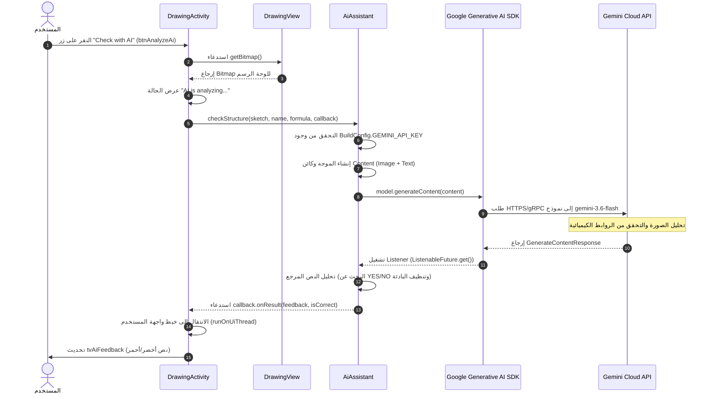

# توثيق استخدام الذكاء الاصطناعي في تطبيق AssembleTheMolecule

يقدم هذا المستند وصفًا فنيًا وتعليميًا شاملاً لدمج تقنيات الذكاء الاصطناعي (AI) في تطبيق Android **AssembleTheMolecule**. يرتكز هذا المستند على تحليل دقيق للكود المصدري للمشروع، وهو موجه لكل من المطورين والطلاب الذين يدرسون تطوير تطبيقات Android ودمج نماذج الشبكات العصبية.

---

## 1. الغرض من الذكاء الاصطناعي

### ميزات التطبيق التي تستخدم الذكاء الاصطناعي
يُستخدم الذكاء الاصطناعي في التطبيق ضمن وحدة **التعرف على التركيبات الكيميائية المرسومة يدويًا** ([DrawingActivity.java](file:///C:/Users/zeevf/AndroidStudioProjects/AssembleTheMolecule/app/src/main/java/zeev/fraiman/assemblethemolecule/DrawingActivity.java)).

### المهام المنجزة
المهام الرئيسية للذكاء الاصطناعي هي **التحليل والتحقق التلقائي من الصيغ البنائية الكيميائية المرسومة يدويًا** على شاشة الجهاز بواسطة المستخدم.

* **الرؤية الحاسوبية (Visual Reasoning):** التعرف على الرموز النصية للعناصر الكيميائية (مثل `H` و `O` و `C` و `N`) التي وضعها المستخدم، بالإضافة إلى الخطوط الرسومية التي تمثل الروابط الكيميائية (أحادية، ثنائية، ثلاثية).
* **التحقق من الصحة الكيميائية:** التأكد من أن عدد الذرات يطابق الصيغة الكيميائية المطلوبة وضمان مراعاة قواعد التكافؤ (Valence) في الربط بين الذرات.

### توزيع المهام بين التطبيق ونموذج الذكاء الاصطناعي

| المكون / المقتضى | التطبيق الأصلي (Android App) | نموذج الذكاء الاصطناعي (Google Gemini) |
| :--- | :--- | :--- |
| **الواجهة والإدخال الرسومي** | يوفر لوحة رسم (`DrawingView`) لرسم الخطوط ووضع رموز العناصر. | لا يشارك. |
| **اختيار المهمة** | يحمل مادة كيميائية عشوائية من قاعدة بيانات SQLite (`HelperDB`). | لا يشارك. |
| **إعداد البيانات** | ينشئ صورة نقطية (`Bitmap`) بخلفية بيضاء ويبني الموجه النصي (Prompt). | لا يشارك. |
| **التعرف والتحقق** | لا يجري أي تحليل صور محلي. | يحلل الصورة والموجه النصي، ويتعرف على المخطط الجزيئي ويتحقق من التكافؤ. |
| **معالجة النتيجة** | يحلل رد النموذج النصي (`YES`/`NO`) ويحدث الألوان والنصوص في الواجهة. | يصيغ النتيجة بلغة طبيعية مع توضيح الأخطاء إن وجدت. |

### البيانات المقدمة للنموذج
تتم مشاركة البيانات التالية مع نموذج الذكاء الاصطناعي:
1. **صورة رسومية (Bitmap):** لقطة للشاشة الافتراضية حيث رسم المستخدم الروابط ووضع الرموز الكيميائية.
2. **بيانات السياق (نص):** اسم المادة (مثل `"Water"`) وصيغتها الكيميائية (مثل `"H2O"`).

### النتيجة المتوقعة
يرجع النموذج إجابة نصية محددة تبدأ بكلمة `YES` (إذا كانت الصورة صحيحة) أو `NO` (إذا كانت هناك أخطاء)، يتبعها شرح من جملة إلى جملتين.

---

## 2. بنية التفاعل مع الذكاء الاصطناعي

يوضح المخطط أدناه تدفق البيانات بين مكونات التطبيق وخدمة الذكاء الاصطناعي الخارجية.

### مسار البيانات خطوة بخطوة

```
[المستخدم] 
   │ 1. ينقر على "Check with AI"
   ▼
[DrawingActivity.java] ──(analyzeWithAi)──► [DrawingView.java]
   │                                             │ 2. getBitmap()
   │ 3. Bitmap + Name + Formula                  ▼
   ▼                                     [Bitmap (White BG)]
[AiAssistant.java] 
   │ 4. checkStructure()
   │ 5. تجميع Content (Text Prompt + Image Bitmap)
   ▼
[Google Generative AI SDK (GenerativeModelFutures)]
   │ 6. طلب gRPC/REST غير متزامن (gemini-3.6-flash)
   ▼
[Google Gemini API Cloud Service]
   │ 7. معالجة الصورة والنص بواسطة الشبكة العصبية
   ▼
[GenerativeModelFutures (ListenableFuture)]
   │ 8. الاستجابة: GenerateContentResponse
   ▼
[AiAssistant.java (Listener)]
   │ 9. تحليل الاستجابة: التحقق من "YES" واستخراج التغذية الراجعة
   │ 10. استدعاء AiCallback.onResult(feedback, isCorrect)
   ▼
[DrawingActivity.java (runOnUiThread)]
   │ 11. تحديث واجهة المستخدم: tvAiFeedback.setText(), setTextColor()
   ▼
[شاشة الجهاز (UI)]
```

### مخطط التسلسل (Mermaid)



---

## 3. جرد مكونات الذكاء الاصطناعي في المشروع

يوضح الجدول أدناه جميع المكونات والملفات والموارد المشاركة في عمليات الذكاء الاصطناعي.

### جدول مكونات الذكاء الاصطناعي

| المكون / الفئة | مسار الملف | الدور في بنية الذكاء الاصطناعي |
| :--- | :--- | :--- |
| [`AiAssistant`](file:///C:/Users/zeevf/AndroidStudioProjects/AssembleTheMolecule/app/src/main/java/zeev/fraiman/assemblethemolecule/utils/AiAssistant.java) | `app/src/main/java/zeev/fraiman/assemblethemolecule/utils/AiAssistant.java` | الفئة الخدمية الرئيسية للتعامل مع Gemini API. تقوم بتهيئة النموذج وبناء الموجهات وإرسال الطلبات وتحليل الاستجابات. |
| [`AiAssistant.AiCallback`](file:///C:/Users/zeevf/AndroidStudioProjects/AssembleTheMolecule/app/src/main/java/zeev/fraiman/assemblethemolecule/utils/AiAssistant.java#L20-L23) | داخل `AiAssistant.java` | واجهة الاستدعاء الذاتي (Callback) لتمرير نتائج الذكاء الاصطناعي غير المتزامنة إلى النشاط. |
| [`DrawingActivity`](file:///C:/Users/zeevf/AndroidStudioProjects/AssembleTheMolecule/app/src/main/java/zeev/fraiman/assemblethemolecule/DrawingActivity.java) | `app/src/main/java/zeev/fraiman/assemblethemolecule/DrawingActivity.java` | نشاط الرسم. يقوم بتهيئة `AiAssistant` ومعالجة نقرات زر التحقق وتمرير `Bitmap` وتحديث الواجهة. |
| [`DrawingView`](file:///C:/Users/zeevf/AndroidStudioProjects/AssembleTheMolecule/app/src/main/java/zeev/fraiman/assemblethemolecule/utils/DrawingView.java) | `app/src/main/java/zeev/fraiman/assemblethemolecule/utils/DrawingView.java` | عرض مخصص للرسم. يولد صورة `Bitmap` نقية بخلفية بيضاء مع الجزيء المرسوم بواسطة `getBitmap()`. |
| [`BuildConfig`](file:///C:/Users/zeevf/AndroidStudioProjects/AssembleTheMolecule/app/build/generated/source/buildConfig/debug/zeev/fraiman/assemblethemolecule/BuildConfig.java) | `app/build/generated/source/buildConfig/.../BuildConfig.java` | فئة Java تم إنشاؤها تلقائيًا تحتوي على الثابت `GEMINI_API_KEY`. |
| `build.gradle.kts` (app) | `app/build.gradle.kts` | ملف تكوين البناء. يتضمن اعتماد مكتبة `generativeai:0.7.0` ويقرأ المفتاح من `local.properties`. |
| `local.properties` | `local.properties` (جذر المشروع) | ملف تكوين محلي (موجود في `.gitignore`) يخزن مفتاح API السري `GEMINI_API_KEY`. |
| `AndroidManifest.xml` | `app/src/main/AndroidManifest.xml` | بيان التطبيق. يتضمن إذن `android.permission.INTERNET` المطلوب لطلبات الشبكة. |
| [`activity_drawing.xml`](file:///C:/Users/zeevf/AndroidStudioProjects/AssembleTheMolecule/app/src/main/res/layout/activity_drawing.xml) | `app/src/main/res/layout/activity_drawing.xml` | تخطيط XML لشاشة الرسم. يحتوي على `btnAnalyzeAi` و `tvAiFeedback`. |
| [`MainActivity`](file:///C:/Users/zeevf/AndroidStudioProjects/AssembleTheMolecule/app/src/main/java/zeev/fraiman/assemblethemolecule/MainActivity.java) | `app/src/main/java/zeev/fraiman/assemblethemolecule/MainActivity.java` | النشاط الرئيسي. يحتوي على زر `btnDraw` الذي يفتح `DrawingActivity`. |

---

## 4. التحليل التفصيلي للدوال والأساليب

### 1. المنشئ `AiAssistant()`
* **اسم المكون:** `zeev.fraiman.assemblethemolecule.utils.AiAssistant`
* **الوظيفة:** ينشئ مثيلاً من `GenerativeModel` باسم النموذج `"gemini-3.6-flash"` والمفتاح `BuildConfig.GEMINI_API_KEY` ويغلفه في `GenerativeModelFutures` لطلبات Java غير المتزامنة.

```java
public AiAssistant() {
    GenerativeModel gm = new GenerativeModel("gemini-3.6-flash", BuildConfig.GEMINI_API_KEY);
    this.model = GenerativeModelFutures.from(gm);
}
```

### 2. الدالة `AiAssistant.checkStructure(...)`
* **الوظيفة:** تجهز موجهًا متعدد الوسائط (نص + صورة)، وترسل طلبًا غير متزامن إلى نموذج الذكاء الاصطناعي وتحلل الاستجابة.

```java
public void checkStructure(Bitmap sketch, String substanceName, String formula, AiCallback callback) {
    if (BuildConfig.GEMINI_API_KEY.isEmpty()) {
        callback.onError("Gemini API key is missing. Please add GEMINI_API_KEY to local.properties.");
        return;
    }

    String prompt = "Analyze this hand-drawn chemical structure for " + substanceName + " (" + formula + "). " +
            "1. Check if symbols and number of atoms are correct. " +
            "2. Check if chemical bonds (lines) are present and correct based on valence rules. " +
            "3. Ignore angles and drawing quality. " +
            "IMPORTANT: Respond in plain text ONLY. Do NOT use LaTeX, stars, or special formatting. " +
            "Start with 'YES' if it is correct or 'NO' if there are errors, followed by a 1-2 sentence explanation.";

    Content content = new Content.Builder()
            .addText(prompt)
            .addImage(sketch)
            .build();

    ListenableFuture<GenerateContentResponse> response = model.generateContent(content);
    
    response.addListener(() -> {
        try {
            GenerateContentResponse result = response.get();
            String text = result.getText();
            boolean isCorrect = text != null && text.trim().toUpperCase().startsWith("YES");
            String feedback = text != null ? text.replaceFirst("(?i)YES", "").replaceFirst("(?i)NO", "").trim() : "No response from AI";
            callback.onResult(feedback, isCorrect);
        } catch (Exception e) {
            callback.onError(e.getMessage());
        }
    }, Runnable::run);
}
```

### 3. الدالة `DrawingActivity.analyzeWithAi()`
* **الوظيفة:** تطلب صورة من `DrawingView` وتحدث حالة الواجهة إلى "AI is analyzing..." وتبدأ التحقق.
* **أمان واجهة المستخدم:** يتم استدعاء `runOnUiThread()` لتحديث عناصر واجهة المستخدم بشكل آمن لأن استجابة الشبكة تعمل في خيط خلفي.

```java
private void analyzeWithAi() {
    Bitmap sketch = drawingView.getBitmap();
    tvAiFeedback.setVisibility(View.VISIBLE);
    tvAiFeedback.setText("AI is analyzing your sketch...");
    tvAiFeedback.setTextColor(getResources().getColor(android.R.color.holo_blue_dark));

    aiAssistant.checkStructure(
            sketch, 
            currentTaskSubstance.getName(), 
            currentTaskSubstance.getFormula(), 
            new AiAssistant.AiCallback() {
                @Override
                public void onResult(String feedback, boolean isCorrect) {
                    runOnUiThread(() -> {
                        tvAiFeedback.setText(isCorrect ? "Correct! " + feedback : "Incorrect. " + feedback);
                        tvAiFeedback.setTextColor(getResources().getColor(
                                isCorrect ? android.R.color.holo_green_dark : android.R.color.holo_red_dark));
                    });
                }

                @Override
                public void onError(String error) {
                    runOnUiThread(() -> {
                        tvAiFeedback.setText("AI Error: " + error);
                        tvAiFeedback.setTextColor(getResources().getColor(android.R.color.holo_red_dark));
                    });
                }
            }
    );
}
```

### 4. الدالة `DrawingView.getBitmap()`
* **الوظيفة:** تنشئ صورة `Bitmap` جديدة بأبعاد لوحة الرسم، وتملؤها بخلفية بيضاء معتمة (`Color.WHITE`)، وترسم عليها خطوط المستخدم ورموز العناصر.

```java
public Bitmap getBitmap() {
    Bitmap result = Bitmap.createBitmap(getWidth(), getHeight(), Bitmap.Config.ARGB_8888);
    Canvas canvas = new Canvas(result);
    canvas.drawColor(Color.WHITE); // خلفية بيضاء لضمان التعرف الصحيح
    draw(canvas);
    return result;
}
```

---

## 5. الموجه النصي وتعليمات النموذج

تتم صياغة الموجه النصي ديناميكيًا في `AiAssistant.checkStructure()`:

```
Analyze this hand-drawn chemical structure for [substanceName] ([formula]). 
1. Check if symbols and number of atoms are correct. 
2. Check if chemical bonds (lines) are present and correct based on valence rules. 
3. Ignore angles and drawing quality. 
IMPORTANT: Respond in plain text ONLY. Do NOT use LaTeX, stars, or special formatting. 
Start with 'YES' if it is correct or 'NO' if there are errors, followed by a 1-2 sentence explanation.
```

---

## 6. التعامل مع الاستجابات والأخطاء

### تحليل الاستجابة
1. **استخراج النص:** `String text = result.getText();`
2. **تحديد النتيجة:** `boolean isCorrect = text != null && text.trim().toUpperCase().startsWith("YES");`
3. **استخراج الشرح:** إزالة `YES`/`NO` باستخدام تعبير نمطي (`replaceFirst`).

---

## 7. الأمان والخصوصية

* **البيانات المنقولة:** يتم إرسال صورة الجزيء واسم المادة وصيغتها فقط. **لا** يتم إرسال أي بيانات شخصية للمستخدم.
* **إدارة مفتاح API:** يتم تخزين المفتاح في `local.properties` (غير مسجل في Git) ويتم تحقينه في `BuildConfig` عند البناء.

---

## 8. خريطة مكونات الذكاء الاصطناعي في المشروع

```
AssembleTheMolecule/
├── app/
│   ├── build.gradle.kts                         [اعتمادية generativeai:0.7.0 وتحميل المفتاح]
│   └── src/main/
│       ├── AndroidManifest.xml                  [إذن INTERNET]
│       ├── java/zeev/fraiman/assemblethemolecule/
│       │   ├── MainActivity.java                [التنقل إلى شاشة الرسم]
│       │   ├── DrawingActivity.java             [واجهة التحقق بالذكاء الاصطناعي]
│       │   └── utils/
│       │       ├── AiAssistant.java             [فئة التكامل مع Gemini API]
│       │       └── DrawingView.java             [منشئ Bitmap للوحة الرسم]
│       └── res/layout/
│           └── activity_drawing.xml             [تخطيط واجهة المستخدم للتحقق]
└── local.properties                             [تخزين GEMINI_API_KEY]
```

---
*تم إنشاؤه لتوثيق بنية وحدة الذكاء الاصطناعي لمشروع AssembleTheMolecule.*
