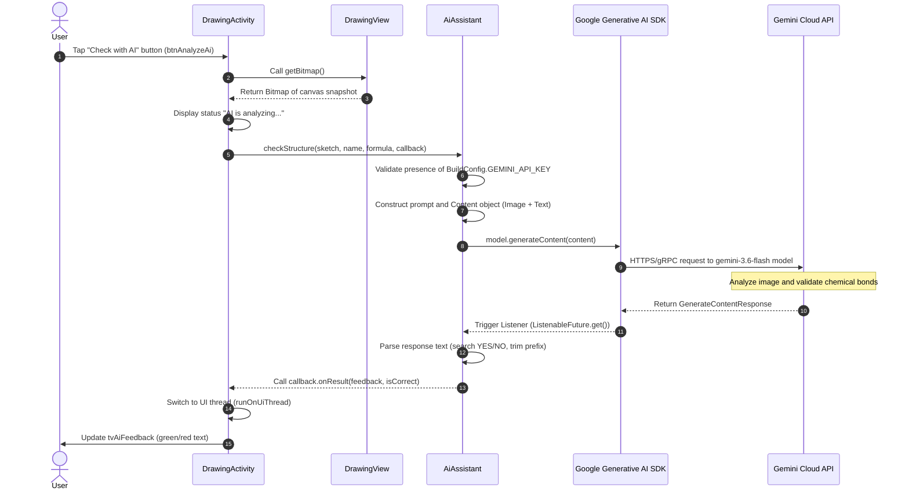

# Documenting Artificial Intelligence Usage in AssembleTheMolecule

This document provides a comprehensive technical and educational description of the Artificial Intelligence (AI) integration in the **AssembleTheMolecule** Android application. It is based on a thorough analysis of the project's source code and is intended for both developers and students learning Android development and neural network model integration.

---

## 1. Purpose of Artificial Intelligence

### App Features Utilizing AI
Artificial Intelligence is used in the **hand-drawn chemical structure recognition** module ([DrawingActivity.java](file:///C:/Users/zeevf/AndroidStudioProjects/AssembleTheMolecule/app/src/main/java/zeev/fraiman/assemblethemolecule/DrawingActivity.java)).

### Tasks Solved
The main task of the AI is the **automatic analysis and validation of hand-drawn chemical structural formulas** drawn by the user on the device screen.

* **Computer Vision (Visual Reasoning):** Recognizing text symbols of chemical elements (e.g., `H`, `O`, `C`, `N`) placed by the user, as well as graphical lines representing chemical bonds (single, double, triple).
* **Chemical Correctness Check:** Verifying that the number of atoms matches the target chemical formula and ensuring element valence rules are satisfied (atoms correctly connected by bonds).

### Task Allocation Between App and AI Model

| Component / Task | Native App (Android App) | AI Model (Google Gemini) |
| :--- | :--- | :--- |
| **Interface & Graphic Input** | Provides a drawing canvas (`DrawingView`) for drawing lines and placing element symbols from the palette. | Not involved. |
| **Task Selection** | Loads a random chemical substance from the SQLite database (`HelperDB`). | Not involved. |
| **Data Preparation** | Generates a raster image (`Bitmap`) with a white background and constructs a text prompt. | Not involved. |
| **Recognition & Validation** | Does not perform local image recognition. | Analyzes the image and text prompt, recognizes the molecular graph, and validates valence. |
| **Verdict Formatting** | Parses the model's text response (`YES`/`NO`) and updates UI colors and text. | Formulates a natural language verdict with error explanations. |

### Provided Information
The following data is passed to the AI model:
1. **Graphical Image (Bitmap):** A snapshot of the virtual canvas where the user drew bonds and placed chemical symbols.
2. **Context Data (Text):** The name of the substance (e.g., `"Water"`) and its chemical formula (e.g., `"H2O"`).

### Expected Result
The model returns a strictly structured text response starting with `YES` (if correct) or `NO` (if there are errors), followed by a 1–2 sentence explanation (e.g., missing hydrogen atoms or incorrect bond counts for oxygen).

### Real User Scenario
1. The user taps **"Structure Drawing"** (`btnDraw`) in the main menu.
2. The app loads a random chemical task from the database (e.g., substance **"Water"** with formula **"H₂O"**).
3. Using the interactive palette, the user places the symbol `O` and two symbols `H` on the canvas, then draws bond lines connecting the oxygen atom to the hydrogen atoms.
4. The user taps **"Check with AI"** (`btnAnalyzeAi`).
5. The screen displays the status "AI is analyzing your sketch...".
6. The app sends the canvas snapshot and task data to the Google Gemini model.
7. Within 1–3 seconds, the neural network returns a response. A green message appears: *"Correct! The structure correctly displays one Oxygen atom bonded to two Hydrogen atoms"* (or a red message explaining errors if elements or bonds are incorrect).

---

## 2. AI Interaction Architecture

The general data flow scheme between app components and the external AI service is presented below.

### Step-by-Step Data Flow

```
[User] 
   │ 1. Taps "Check with AI"
   ▼
[DrawingActivity.java] ──(analyzeWithAi)──► [DrawingView.java]
   │                                             │ 2. getBitmap()
   │ 3. Bitmap + Name + Formula                  ▼
   ▼                                     [Bitmap (White BG)]
[AiAssistant.java] 
   │ 4. checkStructure()
   │ 5. Assemble Content (Text Prompt + Image Bitmap)
   ▼
[Google Generative AI SDK (GenerativeModelFutures)]
   │ 6. Async gRPC/REST request (gemini-3.6-flash)
   ▼
[Google Gemini API Cloud Service]
   │ 7. Neural network processes image and text
   ▼
[GenerativeModelFutures (ListenableFuture)]
   │ 8. Response: GenerateContentResponse
   ▼
[AiAssistant.java (Listener)]
   │ 9. Parse response: check "YES", extract feedback
   │ 10. Call AiCallback.onResult(feedback, isCorrect)
   ▼
[DrawingActivity.java (runOnUiThread)]
   │ 11. Update UI: tvAiFeedback.setText(), setTextColor()
   ▼
[Device Screen (UI)]
```

### Sequence Diagram (Mermaid)



---

## 3. AI Components Inventory

The list below details all components, files, and project resources involved in AI workflows.

### AI Components Table

| Component / Class | File Path | Purpose and Role in AI Architecture |
| :--- | :--- | :--- |
| [`AiAssistant`](file:///C:/Users/zeevf/AndroidStudioProjects/AssembleTheMolecule/app/src/main/java/zeev/fraiman/assemblethemolecule/utils/AiAssistant.java) | `app/src/main/java/zeev/fraiman/assemblethemolecule/utils/AiAssistant.java` | Main wrapper service class for the Gemini API. Initializes model, constructs prompts, sends requests, and parses responses. |
| [`AiAssistant.AiCallback`](file:///C:/Users/zeevf/AndroidStudioProjects/AssembleTheMolecule/app/src/main/java/zeev/fraiman/assemblethemolecule/utils/AiAssistant.java#L20-L23) | Inside `AiAssistant.java` | Callback interface for delivering async AI results back to the UI Activity. |
| [`DrawingActivity`](file:///C:/Users/zeevf/AndroidStudioProjects/AssembleTheMolecule/app/src/main/java/zeev/fraiman/assemblethemolecule/DrawingActivity.java) | `app/src/main/java/zeev/fraiman/assemblethemolecule/DrawingActivity.java` | UI drawing Activity. Initializes `AiAssistant`, handles check button clicks, passes `Bitmap`, and updates result TextView. |
| [`DrawingView`](file:///C:/Users/zeevf/AndroidStudioProjects/AssembleTheMolecule/app/src/main/java/zeev/fraiman/assemblethemolecule/utils/DrawingView.java) | `app/src/main/java/zeev/fraiman/assemblethemolecule/utils/DrawingView.java` | Custom drawing View. Generates a clean `Bitmap` with a white background and drawn molecule via `getBitmap()`. |
| [`BuildConfig`](file:///C:/Users/zeevf/AndroidStudioProjects/AssembleTheMolecule/app/build/generated/source/buildConfig/debug/zeev/fraiman/assemblethemolecule/BuildConfig.java) | `app/build/generated/source/buildConfig/.../BuildConfig.java` | Auto-generated Java class containing the `GEMINI_API_KEY` constant. |
| `build.gradle.kts` (app) | `app/build.gradle.kts` | Module build configuration. Includes `generativeai:0.7.0` dependency, reads API key from `local.properties`, and injects it into `BuildConfig`. |
| `local.properties` | `local.properties` (project root) | Local configuration file (in `.gitignore`) storing the secret `GEMINI_API_KEY`. |
| `AndroidManifest.xml` | `app/src/main/AndroidManifest.xml` | Application manifest. Contains `android.permission.INTERNET` permission required for network requests to Gemini API. |
| [`activity_drawing.xml`](file:///C:/Users/zeevf/AndroidStudioProjects/AssembleTheMolecule/app/src/main/res/layout/activity_drawing.xml) | `app/src/main/res/layout/activity_drawing.xml` | XML layout for drawing screen. Contains `btnAnalyzeAi` (trigger button) and `tvAiFeedback` (AI output display). |
| [`MainActivity`](file:///C:/Users/zeevf/AndroidStudioProjects/AssembleTheMolecule/app/src/main/java/zeev/fraiman/assemblethemolecule/MainActivity.java) | `app/src/main/java/zeev/fraiman/assemblethemolecule/MainActivity.java` | Main Activity. Contains `btnDraw` button that opens `DrawingActivity`. |

---

## 4. Detailed Method Breakdown

### 1. Constructor `AiAssistant()`
* **Component Name:** `zeev.fraiman.assemblethemolecule.utils.AiAssistant`
* **Functionality:** Instantiates `GenerativeModel` with model name `"gemini-3.6-flash"` and `BuildConfig.GEMINI_API_KEY`, wrapping it in `GenerativeModelFutures` for async Java calls.
* **Purpose:** Google Generative AI SDK is written in Kotlin using `suspend` functions. `GenerativeModelFutures` adapts Kotlin coroutines into Guava's `ListenableFuture` for Java compatibility.
* **Parameters:** None.

```java
public AiAssistant() {
    GenerativeModel gm = new GenerativeModel("gemini-3.6-flash", BuildConfig.GEMINI_API_KEY);
    this.model = GenerativeModelFutures.from(gm);
}
```

### 2. Method `AiAssistant.checkStructure(...)`
* **Functionality:** Prepares a multimodal prompt (text + image), sends an async request to the AI model, and parses the response.
* **Signature:**
  `public void checkStructure(Bitmap sketch, String substanceName, String formula, AiCallback callback)`
* **Parameters:**
  * `Bitmap sketch`: Canvas drawing image from user.
  * `String substanceName`: Target substance name (e.g., `"Water"`).
  * `String formula`: Chemical formula (e.g., `"H2O"`).
  * `AiCallback callback`: Callback interface for returning results.
* **Return Value:** `void`.
* **SDK Methods Called:** `Content.Builder()`, `addText()`, `addImage()`, `build()`, `model.generateContent()`, `response.addListener()`.

```java
public void checkStructure(Bitmap sketch, String substanceName, String formula, AiCallback callback) {
    if (BuildConfig.GEMINI_API_KEY.isEmpty()) {
        callback.onError("Gemini API key is missing. Please add GEMINI_API_KEY to local.properties.");
        return;
    }

    String prompt = "Analyze this hand-drawn chemical structure for " + substanceName + " (" + formula + "). " +
            "1. Check if symbols and number of atoms are correct. " +
            "2. Check if chemical bonds (lines) are present and correct based on valence rules. " +
            "3. Ignore angles and drawing quality. " +
            "IMPORTANT: Respond in plain text ONLY. Do NOT use LaTeX, stars, or special formatting. " +
            "Start with 'YES' if it is correct or 'NO' if there are errors, followed by a 1-2 sentence explanation.";

    Content content = new Content.Builder()
            .addText(prompt)
            .addImage(sketch)
            .build();

    ListenableFuture<GenerateContentResponse> response = model.generateContent(content);
    
    response.addListener(() -> {
        try {
            GenerateContentResponse result = response.get();
            String text = result.getText();
            boolean isCorrect = text != null && text.trim().toUpperCase().startsWith("YES");
            String feedback = text != null ? text.replaceFirst("(?i)YES", "").replaceFirst("(?i)NO", "").trim() : "No response from AI";
            callback.onResult(feedback, isCorrect);
        } catch (Exception e) {
            callback.onError(e.getMessage());
        }
    }, Runnable::run);
}
```

### 3. Method `DrawingActivity.analyzeWithAi()`
* **Functionality:** Requests raster image from `DrawingView`, updates UI status to "AI is analyzing...", and triggers check in `AiAssistant`.
* **Trigger:** User taps **"Check with AI"** (`btnAnalyzeAi`).
* **UI Thread Safety:** Because the network callback runs on a background thread (`Runnable::run`), `runOnUiThread()` is called to safely update Android UI components.

```java
private void analyzeWithAi() {
    Bitmap sketch = drawingView.getBitmap();
    tvAiFeedback.setVisibility(View.VISIBLE);
    tvAiFeedback.setText("AI is analyzing your sketch...");
    tvAiFeedback.setTextColor(getResources().getColor(android.R.color.holo_blue_dark));

    aiAssistant.checkStructure(
            sketch, 
            currentTaskSubstance.getName(), 
            currentTaskSubstance.getFormula(), 
            new AiAssistant.AiCallback() {
                @Override
                public void onResult(String feedback, boolean isCorrect) {
                    runOnUiThread(() -> {
                        tvAiFeedback.setText(isCorrect ? "Correct! " + feedback : "Incorrect. " + feedback);
                        tvAiFeedback.setTextColor(getResources().getColor(
                                isCorrect ? android.R.color.holo_green_dark : android.R.color.holo_red_dark));
                    });
                }

                @Override
                public void onError(String error) {
                    runOnUiThread(() -> {
                        tvAiFeedback.setText("AI Error: " + error);
                        tvAiFeedback.setTextColor(getResources().getColor(android.R.color.holo_red_dark));
                    });
                }
            }
    );
}
```

### 4. Method `DrawingView.getBitmap()`
* **Functionality:** Creates a new `Bitmap` matching canvas dimensions, fills it with opaque white (`Color.WHITE`), and renders user strokes and element text.
* **Purpose:** Transparent pixels in Android `Bitmap` can turn black during vision model encoding. A white background guarantees proper line and text contrast.

```java
public Bitmap getBitmap() {
    Bitmap result = Bitmap.createBitmap(getWidth(), getHeight(), Bitmap.Config.ARGB_8888);
    Canvas canvas = new Canvas(result);
    canvas.drawColor(Color.WHITE); // Solid white background for AI vision recognition
    draw(canvas);
    return result;
}
```

---

## 5. Prompts and Request Construction

The instructions for the neural network are dynamically built in `AiAssistant.checkStructure()`.

### Prompt Text
```
Analyze this hand-drawn chemical structure for [substanceName] ([formula]). 
1. Check if symbols and number of atoms are correct. 
2. Check if chemical bonds (lines) are present and correct based on valence rules. 
3. Ignore angles and drawing quality. 
IMPORTANT: Respond in plain text ONLY. Do NOT use LaTeX, stars, or special formatting. 
Start with 'YES' if it is correct or 'NO' if there are errors, followed by a 1-2 sentence explanation.
```

### Semantic Breakdown of the Prompt

1. **Context & Goal:**
   `Analyze this hand-drawn chemical structure for [substanceName] ([formula]).`
   Informs the model which specific substance should be depicted, inserting dynamic values (e.g., `Water` and `H2O`).

2. **Validation Criteria:**
   * `1. Check if symbols and number of atoms are correct.` — Ensures correct atom types and counts.
   * `2. Check if chemical bonds (lines) are present and correct based on valence rules.` — Validates chemical bonds according to valence rules.
   * `3. Ignore angles and drawing quality.` — Crucial instruction to reduce false negatives: lenient regarding line curvature, angle geometry, and hand-drawn quality.

3. **Format Constraints:**
   * `IMPORTANT: Respond in plain text ONLY. Do NOT use LaTeX, stars, or special formatting.` — Disallows Markdown (`**`, `*`), TeX symbols, or special characters so output can be directly displayed in a standard Android `TextView`.
   * `Start with 'YES' if it is correct or 'NO' if there are errors, followed by a 1-2 sentence explanation.` — Dictates a strict binary prefix for straightforward programmatic parsing.

---

## 6. Response Handling and Error Management

### AI Response Format
The model returns plain text.
Example correct response:
`YES The molecule contains one oxygen atom connected to two hydrogen atoms by single bonds.`
Example incorrect response:
`NO The oxygen atom is missing one of the required hydrogen bonds.`

### Parsing Logic
1. **Extract Text:** `String text = result.getText();`
2. **Determine Verdict:**
   ```java
   boolean isCorrect = text != null && text.trim().toUpperCase().startsWith("YES");
   ```
3. **Extract Explanation:**
   ```java
   String feedback = text != null 
       ? text.replaceFirst("(?i)YES", "").replaceFirst("(?i)NO", "").trim() 
       : "No response from AI";
   ```

### Error Scenarios

| Error Scenario | Detection Mechanism | App Behavior |
| :--- | :--- | :--- |
| **Missing API Key** | `BuildConfig.GEMINI_API_KEY.isEmpty()` | Request not sent. Triggers `callback.onError("Gemini API key is missing...")`. |
| **No Network** | Catch `Exception` on `response.get()` | Displays red network error message on UI. |
| **Invalid Key / Server Error** | `ExecutionException` in `Future` | Triggers `callback.onError(e.getMessage())`, shown in red on UI. |
| **Empty Response** | `text == null` | Feedback set to `"No response from AI"`, `isCorrect` set to `false`. |

---

## 7. Security and Privacy

### Transmitted Data
Only the following items are transmitted:
* Canvas snapshot (`Bitmap`).
* Substance name and formula.

No personally identifiable user information (name, location, device IDs) is sent to Google Gemini.

### Key Management
1. `local.properties`: Stores `GEMINI_API_KEY=...` (ignored by Git).
2. `app/build.gradle.kts`: Reads `local.properties` and injects it into `BuildConfig` at build time.
3. `BuildConfig.java`: Contains `public static final String GEMINI_API_KEY = "...";`.

### Security Recommendations
Including the API key in the compiled APK carries decompilation risks. For production, requests should be routed through a backend proxy or Firebase Vertex AI with App Check enabled.

---

## 8. Maintenance and Extension Guide

### Modifying the Prompt
Edit the `prompt` variable in [`AiAssistant.java`](file:///C:/Users/zeevf/AndroidStudioProjects/AssembleTheMolecule/app/src/main/java/zeev/fraiman/assemblethemolecule/utils/AiAssistant.java#L26-L32).

### Changing the Model
Change `"gemini-3.6-flash"` to another model name in `AiAssistant` constructor.

---

## 9. Methodological Explanation: What & Why

1. **Why `GenerativeModelFutures`?**
   Google's Kotlin SDK uses coroutines (`suspend fun`). `GenerativeModelFutures` bridges Kotlin coroutines to Guava's `ListenableFuture` for Java interoperability.

2. **Why White Background `Bitmap`?**
   Transparent pixels encode as black during vision model processing. Forcing `canvas.drawColor(Color.WHITE)` guarantees maximum contrast for drawing lines and text.

3. **Why "Ignore angles"?**
   Touchscreen finger drawings have imperfect geometry. This instruction forces the vision model to validate molecular graph topology rather than aesthetic quality.

---

## 10. AI Components Map

```
AssembleTheMolecule/
├── app/
│   ├── build.gradle.kts                         [generativeai:0.7.0 dependency & key loading]
│   └── src/main/
│       ├── AndroidManifest.xml                  [INTERNET permission]
│       ├── java/zeev/fraiman/assemblethemolecule/
│       │   ├── MainActivity.java                [Navigation to AI drawing screen]
│       │   ├── DrawingActivity.java             [AI check UI Activity]
│       │   └── utils/
│       │       ├── AiAssistant.java             [Gemini API integration class]
│       │       └── DrawingView.java             [Canvas Bitmap snapshot generator]
│       └── res/layout/
│           └── activity_drawing.xml             [UI layout for AI check button & feedback text]
└── local.properties                             [Storage for GEMINI_API_KEY]
```

---
*Created for the AssembleTheMolecule AI module architecture documentation.*
