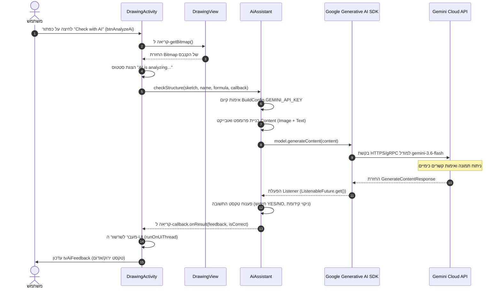

# תיעוד השימוש בבינה מלאכותית באפליקציית AssembleTheMolecule

מסמך זה מספק תיאור טכני וחינוכי מקיף של שילוב טכנולוגיות בינה מלאכותית (AI) באפליקציית ה-Android **AssembleTheMolecule**. המסמך מבוסס על ניתוח מעמיק של קוד המקור של הפרויקט ומיועד הן למפתחים והן לתלמידים הלומדים פיתוח אנדרואיד ושילוב מודלים של רשתות נוירונים.

---

## 1. מטרת הבינה המלאכותית

### תכונות האפליקציה המשתמשות ב-AI
הבינה המלאכותית משמשת באפליקציה במודול **ציור וזיהוי מפתח של מבנים כימיים** ([DrawingActivity.java](file:///C:/Users/zeevf/AndroidStudioProjects/AssembleTheMolecule/app/src/main/java/zeev/fraiman/assemblethemolecule/DrawingActivity.java)).

### המשימות הנפתרות
המשימה המרכזית של ה-AI היא **ניתוח ואימות אוטומטי של נוסחאות מבנה כימיות בציור ידני** המצוירות על ידי המשתמש על גבי מסך המכשיר.

* **ראייה ממוחשבת (Visual Reasoning):** זיהוי סימני טקסט של יסודות כימיים (כגון `H`, `O`, `C`, `N`) שהוצבו על ידי המשתמש, וכן קווים גרפיים המייצגים קשרים כימיים (בודדים, כפולים, משולשים).
* **בדיקת תקינות כימית:** בדיקה שמספר האטומים תואם לנוסחה הכימית המבוקשת, ווידוא שכללי הערכיות (Valence) נשמרים (חיבור נכון של אטומים באמצעות קשרים).

### חלוקת תפקידים בין האפליקציה למודל ה-AI

| רכיב / משימה | אפליקציית אנדרואיד נייטיב | מודל AI (Google Gemini) |
| :--- | :--- | :--- |
| **ממשק וקלט גרפי** | מספקת קנבס לציור (`DrawingView`) לציור קווים והצבת יסודות מפלטה. | אינו משתתף. |
| **בחירת משימה** | טוענת חומר כימי אקראי מסד הנתונים SQLite (`HelperDB`). | אינו משתתף. |
| **הכנת נתונים** | מפיקה תמונת מפת סיביות (`Bitmap`) עם רקע לבן ובונה פרומפט טקסטואלי. | אינו משתתף. |
| **זיהוי ואימות** | אינה מבצעת זיהוי תמונות מקומי. | מנתחת את התמונה והפרומפט, מזהה את הגרף המולקולרי ומאמתת ערכיות. |
| **עיבוד התשובה** | מפענחת את תשובת המודל (`YES`/`NO`) ומעדכנת צבעים וטקסט ב-UI. | מנסחת תשובה בשפה טבעית עם הסבר על שגיאות. |

### הנתונים המסופקים
הנתונים הבאים מועברים למודל ה-AI:
1. **תמונה גרפית (Bitmap):** צילום מסך של הקנבס הווירטואלי שבו המשתמש צייר קשרים והציב סימנים כימיים.
2. **נתוני הקשר (טקסט):** שם החומר (לדוגמה `"Water"`) והנוסחה הכימית שלו (לדוגמה `"H2O"`).

### התוצאה המצופה
המודל מחזיר תשובה טקסטואלית במבנה מוגדר המתחילה במילה `YES` (אם נכון) או `NO` (אם יש שגיאות), ולאחריה הסבר של 1–2 משפטים (לדוגמה, חסרים אטומי הידרוגן או מספר קשרים שגוי עבור חמצן).

### תרחיש משתמש אמיתי
1. המשתמש לוחץ על **"Structure Drawing"** (`btnDraw`) בתפריט הראשי.
2. האפליקציה טוענת משימה כימית אקראית מסד הנתונים (למשל, החומר **"Water"** עם הנוסחה **"H₂O"**).
3. באמצעות הפלטה האינטראקטיבית, המשתמש מציב את הסימן `O` ושני סימני `H` על הקנבס, ומותח קווי קשר בין חמצן למימנים.
4. המשתמש לוחץ על **"Check with AI"** (`btnAnalyzeAi`).
5. המסך מציג סטטוס "AI is analyzing your sketch...".
6. האפליקציה שולחת את תמונת הקנבס ונתוני המשימה למודל Google Gemini.
7. תוך 1–3 שניות, רשת הנוירונים מחזירה תשובה. הודעה ירוקה מופיעה: *"Correct! The structure correctly displays one Oxygen atom bonded to two Hydrogen atoms"* (או הודעה אדומה המסבירה שגיאות).

---

## 2. ארכיטקטורת אינטראקציה עם AI

תרשים זרימת הנתונים בין רכיבי האפליקציה לשירות ה-AI החיצוני מוצג להלן.

### שלבי זרימת הנתונים

```
[משתמש] 
   │ 1. לוחץ על "Check with AI"
   ▼
[DrawingActivity.java] ──(analyzeWithAi)──► [DrawingView.java]
   │                                             │ 2. getBitmap()
   │ 3. Bitmap + Name + Formula                  ▼
   ▼                                     [Bitmap (White BG)]
[AiAssistant.java] 
   │ 4. checkStructure()
   │ 5. הרכבת Content (Text Prompt + Image Bitmap)
   ▼
[Google Generative AI SDK (GenerativeModelFutures)]
   │ 6. בקשת gRPC/REST אסינכרונית (gemini-3.6-flash)
   ▼
[Google Gemini API Cloud Service]
   │ 7. רשת נוירונים מעבדת תמונה וטקסט
   ▼
[GenerativeModelFutures (ListenableFuture)]
   │ 8. תשובה: GenerateContentResponse
   ▼
[AiAssistant.java (Listener)]
   │ 9. פענוח תשובה: בדיקת "YES", חילוץ משוב
   │ 10. קריאה ל-AiCallback.onResult(feedback, isCorrect)
   ▼
[DrawingActivity.java (runOnUiThread)]
   │ 11. עדכון UI: tvAiFeedback.setText(), setTextColor()
   ▼
[מסך המכשיר (UI)]
```

### תרשים רצף (Mermaid)



---

## 3. מפרט רכיבי AI בפרויקט

הטבלה להלן מפרטת את כל הרכיבים, הקבצים והמשאבים המשתתפים בתהליכי ה-AI.

### טבלת רכיבי AI

| רכיב / מחלקה | נתיב קובץ | תפקיד בארכיטקטורת ה-AI |
| :--- | :--- | :--- |
| [`AiAssistant`](file:///C:/Users/zeevf/AndroidStudioProjects/AssembleTheMolecule/app/src/main/java/zeev/fraiman/assemblethemolecule/utils/AiAssistant.java) | `app/src/main/java/zeev/fraiman/assemblethemolecule/utils/AiAssistant.java` | מחלקת שירות ראשית עבור Gemini API. מאתחלת את המודל, בונה פרומפטים, שולחת בקשות ומפענחת תשובות. |
| [`AiAssistant.AiCallback`](file:///C:/Users/zeevf/AndroidStudioProjects/AssembleTheMolecule/app/src/main/java/zeev/fraiman/assemblethemolecule/utils/AiAssistant.java#L20-L23) | בתוך `AiAssistant.java` | ממשק Callback להעברת תוצאות AI אסינכרוניות חזרה ל-UI Activity. |
| [`DrawingActivity`](file:///C:/Users/zeevf/AndroidStudioProjects/AssembleTheMolecule/app/src/main/java/zeev/fraiman/assemblethemolecule/DrawingActivity.java) | `app/src/main/java/zeev/fraiman/assemblethemolecule/DrawingActivity.java` | Activity הציור. מאתחלת את `AiAssistant`, מטפלת בלחיצה על כפתור הבדיקה, מעבירה `Bitmap` ומעדכנת רכיבי UI. |
| [`DrawingView`](file:///C:/Users/zeevf/AndroidStudioProjects/AssembleTheMolecule/app/src/main/java/zeev/fraiman/assemblethemolecule/utils/DrawingView.java) | `app/src/main/java/zeev/fraiman/assemblethemolecule/utils/DrawingView.java` | View מותאם אישית לציור. מפיק `Bitmap` נקי עם רקע לבן והמולקולה המצוירת באמצעות `getBitmap()`. |
| [`BuildConfig`](file:///C:/Users/zeevf/AndroidStudioProjects/AssembleTheMolecule/app/build/generated/source/buildConfig/debug/zeev/fraiman/assemblethemolecule/BuildConfig.java) | `app/build/generated/source/buildConfig/.../BuildConfig.java` | מחלקת Java המיוצרת אוטומטית המכילה את הקבוע `GEMINI_API_KEY`. |
| `build.gradle.kts` (app) | `app/build.gradle.kts` | קובץ הגדרות בניה. כולל תלות ב-`generativeai:0.7.0`, קורא מפתח מ-`local.properties` ומזריק אותו ל-`BuildConfig`. |
| `local.properties` | `local.properties` (שורש הפרויקט) | קובץ הגדרות מקומי (ב-`.gitignore`) המאחסן את מפתח ה-API הסודי `GEMINI_API_KEY`. |
| `AndroidManifest.xml` | `app/src/main/AndroidManifest.xml` | מניפסט האפליקציה. כולל הרשאת `android.permission.INTERNET` הנדרשת לבקשות רשת ל-Gemini API. |
| [`activity_drawing.xml`](file:///C:/Users/zeevf/AndroidStudioProjects/AssembleTheMolecule/app/src/main/res/layout/activity_drawing.xml) | `app/src/main/res/layout/activity_drawing.xml` | פריסת XML למסך הציור. מכילה את `btnAnalyzeAi` (כפתור הפעלה) ו-`tvAiFeedback` (הצגת תשובת AI). |
| [`MainActivity`](file:///C:/Users/zeevf/AndroidStudioProjects/AssembleTheMolecule/app/src/main/java/zeev/fraiman/assemblethemolecule/MainActivity.java) | `app/src/main/java/zeev/fraiman/assemblethemolecule/MainActivity.java` | Activity ראשית. מכילה את הכפתור `btnDraw` הפותח את `DrawingActivity`. |

---

## 4. פירוט מתודולוגי של פונקציות ושיטות

### 1. בנאי `AiAssistant()`
* **שם הרכיב:** `zeev.fraiman.assemblethemolecule.utils.AiAssistant`
* **פעילות:** יוצר מופע של `GenerativeModel` עם שם המודל `"gemini-3.6-flash"` ומפתח `BuildConfig.GEMINI_API_KEY`, ועוטף אותו ב-`GenerativeModelFutures` עבור קריאות Java אסינכרוניות.
* **מטרה:** SDK של Google Generative AI נכתב ב-Kotlin עם פונקציות `suspend`. `GenerativeModelFutures` מתאים קורוטינות Kotlin ל-`ListenableFuture` של Guava לשימוש ב-Java.

```java
public AiAssistant() {
    GenerativeModel gm = new GenerativeModel("gemini-3.6-flash", BuildConfig.GEMINI_API_KEY);
    this.model = GenerativeModelFutures.from(gm);
}
```

### 2. מתודה `AiAssistant.checkStructure(...)`
* **פעילות:** מכינה פרומפט מולטי-מודאלי (טקסט + תמונה), שולחת בקשה אסינכרונית ומפענחת תשובה.
* **פרמטרים:** `Bitmap sketch`, `String substanceName`, `String formula`, `AiCallback callback`.

```java
public void checkStructure(Bitmap sketch, String substanceName, String formula, AiCallback callback) {
    if (BuildConfig.GEMINI_API_KEY.isEmpty()) {
        callback.onError("Gemini API key is missing. Please add GEMINI_API_KEY to local.properties.");
        return;
    }

    String prompt = "Analyze this hand-drawn chemical structure for " + substanceName + " (" + formula + "). " +
            "1. Check if symbols and number of atoms are correct. " +
            "2. Check if chemical bonds (lines) are present and correct based on valence rules. " +
            "3. Ignore angles and drawing quality. " +
            "IMPORTANT: Respond in plain text ONLY. Do NOT use LaTeX, stars, or special formatting. " +
            "Start with 'YES' if it is correct or 'NO' if there are errors, followed by a 1-2 sentence explanation.";

    Content content = new Content.Builder()
            .addText(prompt)
            .addImage(sketch)
            .build();

    ListenableFuture<GenerateContentResponse> response = model.generateContent(content);
    
    response.addListener(() -> {
        try {
            GenerateContentResponse result = response.get();
            String text = result.getText();
            boolean isCorrect = text != null && text.trim().toUpperCase().startsWith("YES");
            String feedback = text != null ? text.replaceFirst("(?i)YES", "").replaceFirst("(?i)NO", "").trim() : "No response from AI";
            callback.onResult(feedback, isCorrect);
        } catch (Exception e) {
            callback.onError(e.getMessage());
        }
    }, Runnable::run);
}
```

### 3. מתודה `DrawingActivity.analyzeWithAi()`
* **פעילות:** מבקשת תמונה מ-`DrawingView`, מעדכנת סטטוס UI ל-"AI is analyzing..." ומפעילה את הבדיקה ב-`AiAssistant`.
* **בטיחות UI:** מכיוון שתשובת הרשת מתקבלת בשרשור רקע, הקריאה ל-`runOnUiThread()` מבטיחה עדכון בטוח של רכיבי ממשק המשתמש באנדרואיד.

```java
private void analyzeWithAi() {
    Bitmap sketch = drawingView.getBitmap();
    tvAiFeedback.setVisibility(View.VISIBLE);
    tvAiFeedback.setText("AI is analyzing your sketch...");
    tvAiFeedback.setTextColor(getResources().getColor(android.R.color.holo_blue_dark));

    aiAssistant.checkStructure(
            sketch, 
            currentTaskSubstance.getName(), 
            currentTaskSubstance.getFormula(), 
            new AiAssistant.AiCallback() {
                @Override
                public void onResult(String feedback, boolean isCorrect) {
                    runOnUiThread(() -> {
                        tvAiFeedback.setText(isCorrect ? "Correct! " + feedback : "Incorrect. " + feedback);
                        tvAiFeedback.setTextColor(getResources().getColor(
                                isCorrect ? android.R.color.holo_green_dark : android.R.color.holo_red_dark));
                    });
                }

                @Override
                public void onError(String error) {
                    runOnUiThread(() -> {
                        tvAiFeedback.setText("AI Error: " + error);
                        tvAiFeedback.setTextColor(getResources().getColor(android.R.color.holo_red_dark));
                    });
                }
            }
    );
}
```

### 4. מתודה `DrawingView.getBitmap()`
* **פעילות:** יוצרת `Bitmap` חדש בגודל הקנבס, ממלאה אותו ברקע לבן אטום (`Color.WHITE`), ומציירת עליו את קווי המשתמש ואותיות היסודות.

```java
public Bitmap getBitmap() {
    Bitmap result = Bitmap.createBitmap(getWidth(), getHeight(), Bitmap.Config.ARGB_8888);
    Canvas canvas = new Canvas(result);
    canvas.drawColor(Color.WHITE); // רקע לבן עבור זיהוי תמונה תקין ב-AI
    draw(canvas);
    return result;
}
```

---

## 5. ניתוח הפרומפט והוראות המודל

ההוראות למודל נבנות באופן דינמי ב-`AiAssistant.checkStructure()`:

```
Analyze this hand-drawn chemical structure for [substanceName] ([formula]). 
1. Check if symbols and number of atoms are correct. 
2. Check if chemical bonds (lines) are present and correct based on valence rules. 
3. Ignore angles and drawing quality. 
IMPORTANT: Respond in plain text ONLY. Do NOT use LaTeX, stars, or special formatting. 
Start with 'YES' if it is correct or 'NO' if there are errors, followed by a 1-2 sentence explanation.
```

---

## 6. טיפול בתגובות ושגיאות

### ניתוח תשובה
1. **חילוץ טקסט:** `String text = result.getText();`
2. **קביעת תוצאה:** `boolean isCorrect = text != null && text.trim().toUpperCase().startsWith("YES");`
3. **חילוץ הסבר:** הסרת `YES`/`NO` באמצעות ביטוי רגולרי (`replaceFirst`).

---

## 7. אבטחה ופרטיות

* **נתונים מועברים:** רק תמונת המולקולה ושם החומר/נוסחה. אנו מזהים משתמש (שם, מיקום) **אינם** מועברים.
* **ניהול מפתח API:** המפתח מאוחסן ב-`local.properties` (לא נשמר ב-Git) ומ הוזרק ל-`BuildConfig` בזמן הבנייה.

---

## 8. מפת רכיבי AI בפרויקט

```
AssembleTheMolecule/
├── app/
│   ├── build.gradle.kts                         [תלות ב-generativeai:0.7.0 שטעינת מפתח]
│   └── src/main/
│       ├── AndroidManifest.xml                  [הרשאת INTERNET]
│       ├── java/zeev/fraiman/assemblethemolecule/
│       │   ├── MainActivity.java                [ניווט למסך ציור AI]
│       │   ├── DrawingActivity.java             [UI בדיקת ציור ב-AI]
│       │   └── utils/
│       │       ├── AiAssistant.java             [מחלקת שילוב Gemini API]
│       │       └── DrawingView.java             [מחולל Bitmap עבור AI]
│       └── res/layout/
│           └── activity_drawing.xml             [פריסת UI עבור בדיקת AI]
└── local.properties                             [אחסון GEMINI_API_KEY]
```

---
*נוצר עבור תיעוד ארכיטקטורת רכיבי AI בפרויקט AssembleTheMolecule.*
