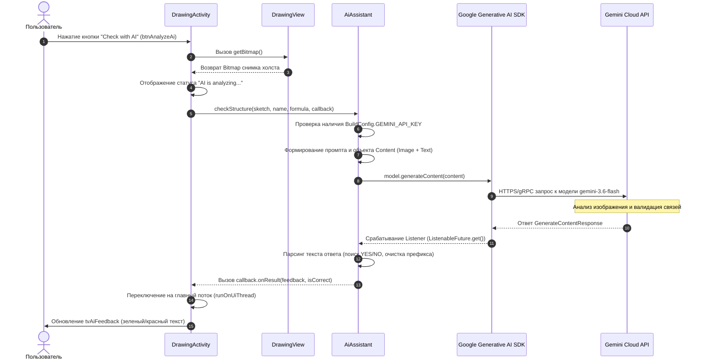

# Документирование использования искусственного интеллекта в приложении AssembleTheMolecule

Данный документ содержит полное техническое и методическое описание использования технологий искусственного интеллекта (ИИ) в Android-приложении **AssembleTheMolecule**. Документ составлен на основе анализа исходного кода проекта и предназначен как для разработчиков, так и для учащихся, изучающих Android-разработку и интеграцию нейросетевых моделей.

---

## 1. Назначение искусственного интеллекта

### Функции приложения с ИИ
Искусственный интеллект используется в приложении в модуле **ручного рисования химических структур** ([DrawingActivity.java](file:///C:/Users/zeevf/AndroidStudioProjects/AssembleTheMolecule/app/src/main/java/zeev/fraiman/assemblethemolecule/DrawingActivity.java)).

### Решаемые задачи
Основная задача ИИ — **автоматический анализ и проверка рукописных химических структурных формул**, нарисованных пользователем на экране устройства.

* **Компьютерное зрение (Visual Reasoning):** распознавание на изображении текстовых символов химических элементов (например, `H`, `O`, `C`, `N`), внесенных пользователем, а также графических линий, обозначающих химические связи (одинарные, двойные, тройные).
* **Проверка химической корректности:** проверка соответствия количества атомов заданной химической формуле, а также соблюдения валентности элементов (правильности соединения атомов связями).

### Распределение задач между приложением и моделью

| Компонент / Задача | Само приложение (Android App) | Модель ИИ (Google Gemini) |
| :--- | :--- | :--- |
| **Интерфейс и графический ввод** | Предоставляет холст (`DrawingView`) для рисования линий и размещения символов элементов из палитры. | Не участвует. |
| **Выбор задания** | Загружает случайное химическое вещество из базы данных SQLite (`HelperDB`). | Не участвует. |
| **Формирование данных** | Подготавливает растровое изображение (Bitmap) с белым фоном и составляет текстовый промпт. | Не участвует. |
| **Распознавание и валидация** | Не выполняет локальное распознавание изображений. | Анализирует изображение и текстовую инструкцию, распознает граф молекулы, проверяет валентность. |
| **Формирование вердикта** | Парсит текстовый ответ модели (`YES`/`NO`), обновляет цвет и текст в UI. | Формирует вердикт на естественном языке с объяснением ошибок. |

### Предоставляемая информация
Модели ИИ передаются следующие данные:
1. **Графическое изображение (Bitmap):** снимок виртуального холста, на котором пользователь нарисовал связи и расставил химические символы.
2. **Контекстные данные (Текст):** название вещества (например, `"Water"`) и его химическая формула (например, `"H2O"`).

### Ожидаемый результат
Модель возвращает строго структурированный текстовый ответ, начинающийся со слова `YES` (если структура верна) или `NO` (если обнаружены ошибки), после чего следует 1–2 предложения с текстовым пояснением (например, о недосчитанных атомах водорода или неверном количестве связей у кислорода).

### Реальный пользовательский сценарий
1. Пользователь в главном меню нажимает кнопку **"Structure Drawing"** (`btnDraw`).
2. Приложение загружает случайную химическую задачу из базы данных (например, вещество **"Water"** с формулой **"H₂O"**).
3. Пользователь с помощью интерактивной палитры выставляет на холст символ `O` и два символа `H`, после чего пальцем проводит линии-связи между атомом кислорода и атомами водорода.
4. Пользователь нажимает кнопку **"Check with AI"** (`btnAnalyzeAi`).
5. На экране отображается индикатор «AI is analyzing your sketch...».
6. Приложение отправляет снимок холста и данные задачи в модель Google Gemini.
7. Через 1–3 секунды нейросеть возвращает ответ. На экране появляется зеленый текст: *«Correct! The structure correctly displays one Oxygen atom bonded to two Hydrogen atoms»* (или красный текст с описанием ошибки, если связи или элементы указаны неверно).

---

## 2. Архитектура взаимодействия с ИИ

Общая схема передачи данных между компонентами приложения и внешним сервисом ИИ представлена ниже.

### Пошаговый путь данных

```
[Пользователь] 
   │ 1. Нажимает "Check with AI"
   ▼
[DrawingActivity.java] ──(analyzeWithAi)──► [DrawingView.java]
   │                                             │ 2. getBitmap()
   │ 3. Bitmap + Name + Formula                  ▼
   ▼                                     [Bitmap (White BG)]
[AiAssistant.java] 
   │ 4. checkStructure()
   │ 5. Сборка Content (Text Prompt + Image Bitmap)
   ▼
[Google Generative AI SDK (GenerativeModelFutures)]
   │ 6. Асинхронный gRPC/REST запрос (gemini-3.6-flash)
   ▼
[Google Gemini API Cloud Service]
   │ 7. Обработка изображения и текста нейросетью
   ▼
[GenerativeModelFutures (ListenableFuture)]
   │ 8. Ответ: GenerateContentResponse
   ▼
[AiAssistant.java (Listener)]
   │ 9. Разбор ответа: проверка "YES", извлечение feedback
   │ 10. Вызов AiCallback.onResult(feedback, isCorrect)
   ▼
[DrawingActivity.java (runOnUiThread)]
   │ 11. Обновление UI: tvAiFeedback.setText(), setTextColor()
   ▼
[Экран устройства (UI)]
```

### Диаграмма взаимодействия в формате Mermaid



---

## 3. Инвентаризация всех ИИ-компонентов

Ниже приведен список всех компонентов, файлов и ресурсов проекта, участвующих в сценариях работы с ИИ.

### Таблица ИИ-компонентов

| Компонент / Класс | Путь к файлу | Назначение и роль в ИИ-архитектуре |
| :--- | :--- | :--- |
| [`AiAssistant`](file:///C:/Users/zeevf/AndroidStudioProjects/AssembleTheMolecule/app/src/main/java/zeev/fraiman/assemblethemolecule/utils/AiAssistant.java) | `app/src/main/java/zeev/fraiman/assemblethemolecule/utils/AiAssistant.java` | Основной сервисный класс-обертка для работы с Gemini API. Создает модель, формирует промпты, отправляет запросы и разбирает ответы. |
| [`AiAssistant.AiCallback`](file:///C:/Users/zeevf/AndroidStudioProjects/AssembleTheMolecule/app/src/main/java/zeev/fraiman/assemblethemolecule/utils/AiAssistant.java#L20-L23) | Внутри `AiAssistant.java` | Интерфейс обратного вызова для передачи результатов от асинхронного потока ИИ в UI-активность. |
| [`DrawingActivity`](file:///C:/Users/zeevf/AndroidStudioProjects/AssembleTheMolecule/app/src/main/java/zeev/fraiman/assemblethemolecule/DrawingActivity.java) | `app/src/main/java/zeev/fraiman/assemblethemolecule/DrawingActivity.java` | UI-активность рисования. Инициализирует `AiAssistant`, обрабатывает нажатие кнопки проверки, передает `Bitmap` и обновляет текстовое поле результатов. |
| [`DrawingView`](file:///C:/Users/zeevf/AndroidStudioProjects/AssembleTheMolecule/app/src/main/java/zeev/fraiman/assemblethemolecule/utils/DrawingView.java) | `app/src/main/java/zeev/fraiman/assemblethemolecule/utils/DrawingView.java` | Кастомный View для рисования. Формирует чистый `Bitmap` с белым фоном и нарисованной молекулой через метод `getBitmap()`. |
| [`BuildConfig`](file:///C:/Users/zeevf/AndroidStudioProjects/AssembleTheMolecule/app/build/generated/source/buildConfig/debug/zeev/fraiman/assemblethemolecule/BuildConfig.java) | `app/build/generated/source/buildConfig/.../BuildConfig.java` | Автоматически сгенерированный класс Java, содержащий константу `GEMINI_API_KEY`. |
| `build.gradle.kts` (app) | `app/build.gradle.kts` | Конфигурационный файл сборки модуля. Подключает библиотеку `generativeai:0.7.0`, считывает API-ключ из `local.properties` и внедряет его в `BuildConfig`. |
| `local.properties` | `local.properties` (корень проекта) | Локальный конфигурационный файл (в `.gitignore`), хранящий секретный ключ `GEMINI_API_KEY`. |
| `AndroidManifest.xml` | `app/src/main/AndroidManifest.xml` | Манифест приложения. Содержит разрешение `android.permission.INTERNET`, необходимое для отправки сетевых запросов к Gemini API. |
| [`activity_drawing.xml`](file:///C:/Users/zeevf/AndroidStudioProjects/AssembleTheMolecule/app/src/main/res/layout/activity_drawing.xml) | `app/src/main/res/layout/activity_drawing.xml` | XML-разметка экрана рисования. Содержит элементы `btnAnalyzeAi` (кнопка запуска) и `tvAiFeedback` (вывод ответа ИИ). |
| [`MainActivity`](file:///C:/Users/zeevf/AndroidStudioProjects/AssembleTheMolecule/app/src/main/java/zeev/fraiman/assemblethemolecule/MainActivity.java) | `app/src/main/java/zeev/fraiman/assemblethemolecule/MainActivity.java` | Главная активность. Содержит кнопку `btnDraw`, открывающую `DrawingActivity`. |

---

## 4. Подробный разбор методов и команд

### 1. Конструктор `AiAssistant()`
* **Имя компонента:** `zeev.fraiman.assemblethemolecule.utils.AiAssistant`
* **Что делает:** Создает экземпляр модели `GenerativeModel` с именем `"gemini-3.6-flash"` и переданным ключом `BuildConfig.GEMINI_API_KEY`, после чего оборачивает его в `GenerativeModelFutures` для поддержки асинхронных вызовов в Java.
* **Зачем нужен:** SDK Google Generative AI написан на Kotlin и использует `suspend`-функции. Для работы из Java-кода требуется адаптер `GenerativeModelFutures`, возвращающий `ListenableFuture`.
* **Параметры:** Отсутствуют.

```java
public AiAssistant() {
    GenerativeModel gm = new GenerativeModel("gemini-3.6-flash", BuildConfig.GEMINI_API_KEY);
    this.model = GenerativeModelFutures.from(gm);
}
```

### 2. Метод `AiAssistant.checkStructure(...)`
* **Что делает:** Подготавливает мультимодальный промпт (текст + изображение), отправляет асинхронный запрос к модели ИИ и обрабатывает полученный ответ.
* **Сигнатура:**
  `public void checkStructure(Bitmap sketch, String substanceName, String formula, AiCallback callback)`
* **Принимаемые параметры:**
  * `Bitmap sketch`: растровое изображение рисунка пользователя с холста.
  * `String substanceName`: название искомого вещества (например, `"Water"`).
  * `String formula`: химическая формула (например, `"H2O"`).
  * `AiCallback callback`: интерфейс обратного вызова для передачи ответа.
* **Возвращаемое значение:** `void`.
* **Вызываемые методы SDK:** `Content.Builder()`, `addText()`, `addImage()`, `build()`, `model.generateContent()`, `response.addListener()`.

```java
public void checkStructure(Bitmap sketch, String substanceName, String formula, AiCallback callback) {
    if (BuildConfig.GEMINI_API_KEY.isEmpty()) {
        callback.onError("Gemini API key is missing. Please add GEMINI_API_KEY to local.properties.");
        return;
    }

    String prompt = "Analyze this hand-drawn chemical structure for " + substanceName + " (" + formula + "). " +
            "1. Check if symbols and number of atoms are correct. " +
            "2. Check if chemical bonds (lines) are present and correct based on valence rules. " +
            "3. Ignore angles and drawing quality. " +
            "IMPORTANT: Respond in plain text ONLY. Do NOT use LaTeX, stars, or special formatting. " +
            "Start with 'YES' if it is correct or 'NO' if there are errors, followed by a 1-2 sentence explanation.";

    Content content = new Content.Builder()
            .addText(prompt)
            .addImage(sketch)
            .build();

    ListenableFuture<GenerateContentResponse> response = model.generateContent(content);
    
    response.addListener(() -> {
        try {
            GenerateContentResponse result = response.get();
            String text = result.getText();
            boolean isCorrect = text != null && text.trim().toUpperCase().startsWith("YES");
            String feedback = text != null ? text.replaceFirst("(?i)YES", "").replaceFirst("(?i)NO", "").trim() : "No response from AI";
            callback.onResult(feedback, isCorrect);
        } catch (Exception e) {
            callback.onError(e.getMessage());
        }
    }, Runnable::run);
}
```

### 3. Метод `DrawingActivity.analyzeWithAi()`
* **Что делает:** Запрашивает растровое изображение у `DrawingView`, обновляет состояние интерфейса на «AI is analyzing...» и вызывает метод проверки в `AiAssistant`.
* **Когда вызывается:** При нажатии пользователем на кнопку **"Check with AI"** (`btnAnalyzeAi`).
* **Взаимодействие с UI-потоком:** Так как сетевой ответ от `AiAssistant` приходит в фоновом потоке выполнения `Runnable::run`, метод обратного вызова использует `runOnUiThread()` для безопасности обновления компонентов Android UI.

```java
private void analyzeWithAi() {
    Bitmap sketch = drawingView.getBitmap();
    tvAiFeedback.setVisibility(View.VISIBLE);
    tvAiFeedback.setText("AI is analyzing your sketch...");
    tvAiFeedback.setTextColor(getResources().getColor(android.R.color.holo_blue_dark));

    aiAssistant.checkStructure(
            sketch, 
            currentTaskSubstance.getName(), 
            currentTaskSubstance.getFormula(), 
            new AiAssistant.AiCallback() {
                @Override
                public void onResult(String feedback, boolean isCorrect) {
                    runOnUiThread(() -> {
                        tvAiFeedback.setText(isCorrect ? "Correct! " + feedback : "Incorrect. " + feedback);
                        tvAiFeedback.setTextColor(getResources().getColor(
                                isCorrect ? android.R.color.holo_green_dark : android.R.color.holo_red_dark));
                    });
                }

                @Override
                public void onError(String error) {
                    runOnUiThread(() -> {
                        tvAiFeedback.setText("AI Error: " + error);
                        tvAiFeedback.setTextColor(getResources().getColor(android.R.color.holo_red_dark));
                    });
                }
            }
    );
}
```

### 4. Метод `DrawingView.getBitmap()`
* **Что делает:** Создает новый объект `Bitmap` с физическими размерами холста, закрашивает его непрозрачным белым цветом (`Color.WHITE`) и принудительно отрисовывает на нем пользовательские линии и тексты элементов.
* **Зачем нужен:** По умолчанию прозрачные пиксели холста могут некорректно обрабатываться нейросетью. Заливка белым фоном гарантирует четкий контраст черных линий и синих букв элементов.

```java
public Bitmap getBitmap() {
    Bitmap result = Bitmap.createBitmap(getWidth(), getHeight(), Bitmap.Config.ARGB_8888);
    Canvas canvas = new Canvas(result);
    canvas.drawColor(Color.WHITE); // Белый фон для корректного распознавания ИИ
    draw(canvas);
    return result;
}
```

---

## 5. Промпты и формирование запросов

Инструкция для нейросети формируется динамически в методе `AiAssistant.checkStructure()`.

### Текст промпта
```
Analyze this hand-drawn chemical structure for [substanceName] ([formula]). 
1. Check if symbols and number of atoms are correct. 
2. Check if chemical bonds (lines) are present and correct based on valence rules. 
3. Ignore angles and drawing quality. 
IMPORTANT: Respond in plain text ONLY. Do NOT use LaTeX, stars, or special formatting. 
Start with 'YES' if it is correct or 'NO' if there are errors, followed by a 1-2 sentence explanation.
```

### Разбор смысловых частей промпта

1. **Контекст и ролевая задача:**
   `Analyze this hand-drawn chemical structure for [substanceName] ([formula]).`
   Сообщает модели, какое конкретно вещество должно быть изображено на рисунке, подставляя динамические значения (например, `Water` и `H2O`).

2. **Критерии валидации:**
   * `1. Check if symbols and number of atoms are correct.` — проверка присутствия всех атомов в нужной пропорции.
   * `2. Check if chemical bonds (lines) are present and correct based on valence rules.` — физическая проверка химических связей между атомами согласно их валентности.
   * `3. Ignore angles and drawing quality.` — важная инструкция для снижения количества ложных срабатываний: нейросеть снисходительно относится к кривизне линий, геометрии углов и качеству почерка.

3. **Ограничения на формат ответа:**
   * `IMPORTANT: Respond in plain text ONLY. Do NOT use LaTeX, stars, or special formatting.` — запрещает использовать Markdown-выделения (`**`, `*`), TeX-символы или спецсимволы, чтобы текст можно было сразу выводить в стандартный `TextView` без спецобработки.
   * `Start with 'YES' if it is correct or 'NO' if there are errors, followed by a 1-2 sentence explanation.` — задает строго определенный бинарный флаг в самом начале ответа для программного парсинга вердикта.

---

## 6. Обработка ответа и ошибок

### Формат ответа ИИ
Модель возвращает обычную текстовую строку (Plain Text). 
Пример верного ответа:
`YES The molecule contains one oxygen atom connected to two hydrogen atoms by single bonds.`
Пример неверного ответа:
`NO The oxygen atom is missing one of the required hydrogen bonds.`

### Логика разбора ответа
В слушателе `addListener` выполняется следующий алгоритм:

1. **Извлечение текста:** `String text = result.getText();`
2. **Определение вердикта:** 
   ```java
   boolean isCorrect = text != null && text.trim().toUpperCase().startsWith("YES");
   ```
   Проверяется наличие строки и то, начинается ли она со слова `YES` (без учета регистра и начальных пробелов).
3. **Извлечение пояснения:**
   ```java
   String feedback = text != null 
       ? text.replaceFirst("(?i)YES", "").replaceFirst("(?i)NO", "").trim() 
       : "No response from AI";
   ```
   С помощью регулярных выражений из строки удаляется первоначальное `YES` или `NO`, а оставшийся пояснительный текст очищается от крайних пробелов.

### Обработка ошибок и исключений

| Сценарий ошибки | Механизм обнаружения | Реакция приложения |
| :--- | :--- | :--- |
| **Отсутствует API-ключ** | `BuildConfig.GEMINI_API_KEY.isEmpty()` | Запрос не отправляется. Вызывается `callback.onError("Gemini API key is missing...")`. |
| **Нет подключения к сети** | Перехват `Exception` при вызове `response.get()` | В UI выводится красное сообщение с текстом ошибки сети. |
| **Неверный API-ключ / Ошибка сервера Gemini** | `ExecutionException` в `Future` | Вызывается `callback.onError(e.getMessage())`, выводится красным в `tvAiFeedback`. |
| **Пустой ответ от модели** | `text == null` | Пояснение заменяется на статус `"No response from AI"`, `isCorrect` устанавливается в `false`. |

### Поведение интерфейса
* Во время ожидания кнопка не блокируется повторно (рекомендуется улучшить), в `tvAiFeedback` выводится синий текст информирования: `"AI is analyzing your sketch..."`.
* После завершения цвет текста меняется на зеленый (`holo_green_dark`) при успехе или красный (`holo_red_dark`) при ошибке.

---

## 7. Безопасность и конфиденциальность

### Передаваемые данные
Приложению и модели Gemini передаются **исключительно**:
* Сгенерированный графический растр рисунка с холста (`Bitmap`).
* Название и формула химического вещества.

Никакие персональные данные пользователя (имя, местоположение, идентификаторы устройства) в сервис Google Gemini **не передаются**.

### Хранение конфигурации и API-ключей
1. **Файл `local.properties`:** Хранит строку `GEMINI_API_KEY=...`. Этот файл находится в корне проекта и включен в `.gitignore`, что предотвращает попадание ключа в публичные репозитории VCS.
2. **Файл `app/build.gradle.kts`:** Во время сборки читает `local.properties` и внедряет значение в сгенерированный класс `BuildConfig`:
   ```kotlin
   val properties = Properties()
   val localPropertiesFile = project.rootProject.file("local.properties")
   if (localPropertiesFile.exists()) {
       properties.load(localPropertiesFile.inputStream())
   }
   val geminiApiKey = (properties.getProperty("GEMINI_API_KEY") ?: "").trim().removeSurrounding("\"")
   buildConfigField("String", "GEMINI_API_KEY", "\"$geminiApiKey\"")
   ```
3. **Сгенерированный `BuildConfig.java`:** Содержит константу `public static final String GEMINI_API_KEY = "...";`.

### Выявленные риски безопасности
* **Хранение ключа в APK:** API-ключ внедряется непосредственно в исходный код Java (`BuildConfig`). При декомпиляции итогового APK-файла злоумышленник может извлечь данный ключ.
* *Рекомендация по улучшению:* В продакшен-версии рекомендуется выполнять запросы к ИИ через промежуточный защищенный сервер (Backend Proxy) или использовать Firebase Vertex AI SDK с включенным механизмом App Check.

---

## 8. Инструкция по сопровождению и расширению

### Как изменить промпт
Для изменения инструкций модели откройте файл [`AiAssistant.java`](file:///C:/Users/zeevf/AndroidStudioProjects/AssembleTheMolecule/app/src/main/java/zeev/fraiman/assemblethemolecule/utils/AiAssistant.java) и отредактируйте локальную переменную `prompt` внутри метода `checkStructure`:

```java
// app/src/main/java/zeev/fraiman/assemblethemolecule/utils/AiAssistant.java
String prompt = "Ваш новый текст промпта...";
```

### Как изменить модель Gemini
По умолчанию используется модель `"gemini-3.6-flash"`. Для замены модели (например, на `"gemini-1.5-flash"` или `"gemini-1.5-pro"`) измените параметр в конструкторе `AiAssistant`:

```java
public AiAssistant() {
    GenerativeModel gm = new GenerativeModel("gemini-1.5-flash", BuildConfig.GEMINI_API_KEY);
    this.model = GenerativeModelFutures.from(gm);
}
```

### Как добавить новый ИИ-сценарий
1. Добавьте новый метод в `AiAssistant.java` (например, `generateSubstanceFact(String formula, AiCallback callback)`).
2. Сформируйте текстовый или мультимодальный запрос и вызовите `model.generateContent(...)`.
3. Создайте UI-компонент для отображения результата и вызовите новый метод из соответствующей Activity.

---

## 9. Методическое объяснение: что делает код и почему

В данном разделе подробно разбираются ключевые методические аспекты реализации для разработчиков и учащихся.

### 1. Почему используется `GenerativeModelFutures`?
В официальном SDK Google Generative AI для Android основной API разработан на языке **Kotlin** с использованием корутин (`suspend fun generateContent`). Так как основной код проекта **AssembleTheMolecule** написан на языке **Java**, прямое использование Kotlin-корутин затруднено. Для этого Google предоставляет класс-обертку `GenerativeModelFutures`, который адаптирует асинхронные вызовы под стандартный Java-интерфейс `ListenableFuture` (из библиотеки Google Guava).

### 2. Почему рисунок передается как `Bitmap` с явным белым фоном?
По умолчанию прозрачный фон в Android `Bitmap` может кодироваться черным цветом или нулевыми альфа-каналами при экспорте в нейросеть. Черные чернила на черном фоне делают рисунок невидимым для модели компьютерного зрения. В `DrawingView.getBitmap()` выполняется принудительная закраска слоя белым цветом (`canvas.drawColor(Color.WHITE)`), что гарантирует максимальный контраст.

### 3. Зачем в промпте указана инструкция "Ignore angles and drawing quality"?
Нейросети глубокого обучения могут быть строги к геометрии изображений. В учебном приложении пользователи рисуют пальцем на сенсорном экране, из-за чего связи часто получаются кривыми, а углы между связями — неидеальными. Инструкция явно указывает ИИ проверять только топологию молекулярного графа (наличие связей и валидность валентностей), а не эстетическое качество рисунка.

---

## 10. Краткая карта ИИ-компонентов

Сводная справочная таблица всех ключевых файлов и компонентов ИИ в проекте:

```
AssembleTheMolecule/
├── app/
│   ├── build.gradle.kts                         [Подключение библиотеки generativeai:0.7.0 и считывание ключа]
│   └── src/main/
│       ├── AndroidManifest.xml                  [Разрешение INTERNET]
│       ├── java/zeev/fraiman/assemblethemolecule/
│       │   ├── MainActivity.java                [Переход к экрану рисования с ИИ]
│       │   ├── DrawingActivity.java             [UI проверки рисунка с помощью ИИ]
│       │   └── utils/
│       │       ├── AiAssistant.java             [Класс интеграции с Gemini API]
│       │       └── DrawingView.java             [Генератор Bitmap изображения холста]
│       └── res/layout/
│           └── activity_drawing.xml             [Разметка UI с кнопкой и текстовым полем ответа ИИ]
└── local.properties                             [Хранение GEMINI_API_KEY]
```

---
*Документ создан в рамках документирования архитектуры ИИ-модулей проекта AssembleTheMolecule.*
